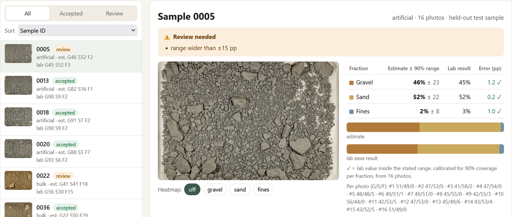

# SoilSight

**Estimate a soil sample's gravel / sand / fines fractions from lab tray photos, with a calibrated range, a review flag when the model is unsure, the most similar lab-tested samples as evidence, and a grain-size heatmap.**

**[Live showcase: 63 held-out test samples next to their lab results](https://huggingface.co/spaces/petrichorgreen/soilsight-showcase)**



## Results

Evaluated once on 63 held-out samples the model never saw during training or tuning:

| | |
|---|---|
| Mean absolute error (gravel, sand, fines) | **4.8 percentage points** (4.7 / 4.9 / 4.9) |
| Baseline: always predict the training average | 16.0 pp |
| 90% ranges containing the lab value | 94% gravel · 95% sand · 95% fines (87% all three at once) |
| Auto-accepted by the review flag | 43% (error 4.3 pp accepted vs 5.3 pp flagged) |

Model comparison, 5-fold cross-validation on 199 development samples (mean absolute error, pp):

| Features | Mean error (pp) |
|---|---|
| Always predict the average | 16.9 |
| Hand-made colour / texture features | 12.2 |
| EfficientNet-B0 (ImageNet) | 6.7 |
| DINOv3 ConvNeXt-T | 6.2 |
| DINOv3 ViT-S/16 | 6.1 |
| **DINOv3 ConvNeXt-T + ViT-S (used)** | **5.8** |
| ViT-S patch head (the heatmap) | 7.0 |

With 63 test samples, the gap between test (4.8) and cross-validation (5.8) is within sampling noise; about 5–6 pp is the honest expectation.

## How it works


1. **Find the soil.** The white tray is masked out; 12 full-resolution 768 px crops (~30 mm at ~40 µm/px) and an overview are taken from inside the soil area.
2. **Describe it.** Frozen DINOv3 backbones (ConvNeXt-T and ViT-S/16) embed the crops and the overview. Nothing is fine-tuned: with ~250 labelled samples, frozen features with a small head generalise better and make every experiment take seconds.
3. **Estimate.** A ridge regression predicts the three fractions per photo, each photo weighted so every *sample* counts equally; a sample's photos are averaged.
4. **Say how sure it is.** A normalised split-conformal range, scaled by how much the 10 most similar lab samples disagree with each other. The first version used disagreement between a sample's own photos; it flagged 96% of samples and did not track error, so five candidate signals were compared on out-of-fold errors and the best kept. Samples with any range wider than ±14.8 pp are flagged for review.
5. **Show the evidence.** The five most similar lab-tested samples (cosine similarity of DINOv3 embeddings) with their real sieve curves.
6. **Show where.** A linear head on ViT patch tokens gives every 16 px patch its own estimate. Because the head is linear, the patch estimates average back exactly to the photo's estimate.
7. **Refuse gracefully.** Photos without a tray, at the wrong scale, or unlike the training data trigger up to four independent warnings.

## Data pipeline

The [Photogranulometry v1.0](https://doi.org/10.20383/103.01316) dataset is 12,714 photos (45 MP each, 441 GB) of 321 soil samples with laboratory sieve results. The cache builder streams 2 photos per tray from the repository in batches, verifies SHA-256 checksums, writes the overview, crops and soil mask, uploads the batch to a private Hugging Face dataset and deletes the originals. Reruns resume where they stopped; every batch gets a QC contact sheet. Scale (~39.8 µm/px) is read from ArUco markers in the calibration photos.

All splits are by **sample**: every photo, tray and moisture state of a sample stays in one split (199 dev in 5 folds, 49 calibration, 63 test). The dataset audit is in [`docs/AUDIT.md`](docs/AUDIT.md).

## Repository layout

```
soilsight/      core package
  scale.py        image scale from the ArUco calibration markers
  views.py        soil mask, overview and crop placement
  cache.py        resumable download → verify → views → upload pipeline
  features.py     frozen backbones + handcrafted features
  heads.py        ridge heads, grouped CV, conformal ranges, retrieval, difficulty signals
  predict.py      inference used by both the app and the showcase
space/          Gradio app (upload photos, evidence, heatmap, technician log)
site/           static showcase page (HTML/CSS/JS reading data.json)
notebooks/      Kaggle notebooks, generated by scripts/make_*_notebook.py
  01 cache (CPU) · 02 features + model (GPU) · 02b uncertainty (CPU)
  03 Gradio Space (needs HF PRO) · 04 test results + showcase (CPU) · 05 live demo link
scripts/        dataset audit, split, download manifest, notebook generators
data/           sample-level split, download manifests, per-sample lab curves
tests/          unit tests on synthetic data (run in CI)
docs/           dataset audit, development log, images
```

## Reproduce

The pipeline runs on free Kaggle notebooks with a Hugging Face account (write token stored as the Kaggle secret `HF_TOKEN`; accept the DINOv3 licence on the Hub first).

1. `01_build_cache.ipynb` (CPU, ~1.75 h): set `EXAMPLE_LINK` to any file link from the FRDR dataset page.
2. `02_train.ipynb` (GPU T4, ~1.9 h, mostly feature extraction; reruns take seconds).
3. `02b_uncertainty.ipynb` (CPU, ~1 min).
4. `04_test_and_showcase.ipynb` (CPU, ~10 min): opens the test split once and publishes the static showcase.
5. `05_live_demo.ipynb`: run interactively for a temporary public link to the full app.

To regenerate a notebook after changing the package: `python scripts/make_train_notebook.py .` (and similarly for the others). Tests: `pip install -r requirements-dev.txt && pytest`.

## Limits

- Visual estimate only. There is no plasticity information, so this is not an engineering soil classification; lab tests are still required.
- Trained on soils from the Montréal region photographed with one lab setup at ~40 µm/px. Other cameras, distances and soils are outside what the model has learned; arbitrary web photos are flagged, not measured.
- Fractions follow the BNQ sieve boundaries (gravel > 5 mm, fines < 0.08 mm). The review flag separated errors strongly on calibration samples (4.2 vs 10.7 pp) but only modestly on the test split (4.3 vs 5.3 pp): a useful triage signal, not a guarantee.

## Credits

Data: Plante St-Cyr, T., Duhaime, F., Dubé, J.-S. & Grenier, S. (2025). *Photogranulometry – Dataset of soil images with corresponding particle size distributions* (v1.0). Federated Research Data Repository. doi:10.20383/103.01316. Licensed CC BY 4.0. Images in `docs/images` are derived from it.

Backbones: DINOv3 (Siméoni et al., 2025, Meta AI; DINOv3 License) and EfficientNet-B0 via `timm`. Model weights are not redistributed here.

Code: MIT licence (see `LICENSE`).
